<picture>
  <source media="(prefers-color-scheme: dark)" srcset="assets/hero-dark.svg">
  
</picture>

&nbsp;

I learn by breaking things. Hand me a stack I've never touched and a deadline, and I'll ship something real with it by the weekend. This October that meant **14 projects in 12 days**, from MCP servers to quantum error correction to zero-knowledge privacy. By day I build agents for real business systems, where the rule flips: nothing ships until it's measured.

&nbsp;

<table>
<tr>
<td width="33%" valign="top"><code>01</code> &nbsp;<b>Break it</b> Take it apart until I know why it works. The docs are where I start, not where I stop.</td>
<td width="33%" valign="top"><code>02</code> &nbsp;<b>Build it</b> Ship something real on a deadline. A weekend is enough to learn most stacks.</td>
<td width="33%" valign="top"><code>03</code> &nbsp;<b>Prove it</b> Evals, baselines, receipts. If I can't measure it, it doesn't ship.</td>
</tr>
</table>

&nbsp;

#### My learning curve, literally

<picture>
  <source media="(prefers-color-scheme: dark)" srcset="assets/curve-dark.svg">
  
</picture>

Counted from the stack of every public repo I create, and redrawn every day by a GitHub Action. It only goes up if I keep learning.

&nbsp;

#### The last 30 days, as a git log

<picture>
  <source media="(prefers-color-scheme: dark)" srcset="assets/gitlog-dark.svg">
  
</picture>

`main` is the day job. Every branch is a night or a weekend.

&nbsp;

#### Selected work

<table>
<tr>
<td width="50%" valign="top">

**[countertop](https://github.com/RohanGlitched/countertop)** &nbsp;AGENTS · MCP

Test any MCP server the way a smart display would: by voice, with its MCP App views on screen.

`voice → Claude on Bedrock → MCP server → App view` 
[live ↗](https://countertop-mcp.vercel.app) &nbsp;·&nbsp; [code ↗](https://github.com/RohanGlitched/countertop)

</td>
<td width="50%" valign="top">

**[exhibit](https://github.com/RohanGlitched/exhibit)** &nbsp;AGENTS · GROUNDING

Dispute desk for PayPal sellers. Every sentence of the response is pinned to the record that proves it.

`dispute → agent → PayPal records → cited reply` 
[live ↗](https://exhibit-desk.vercel.app) &nbsp;·&nbsp; [code ↗](https://github.com/RohanGlitched/exhibit)

</td>
</tr>
<tr>
<td width="50%" valign="top">

**[routed](https://github.com/RohanGlitched/routed)** &nbsp;AGENTS · EVALS

Routes indie tours to where fans over-index, then proves the lift against a no-tool baseline.

`artist → agent → Qloo taste graph → route vs. baseline` 
[live ↗](https://routed-tours.vercel.app) &nbsp;·&nbsp; [code ↗](https://github.com/RohanGlitched/routed)

</td>
<td width="50%" valign="top">

**[dialed](https://github.com/RohanGlitched/dialed)** &nbsp;AGENTS · VISION

Reads analog gauges from a photo. The agent logs the reading, asks for a retake, or waits for a human.

`photo → OpenCV 5 → agent → log / retake / hold` 
[live ↗](https://d3p9dcbwy0l1n8.cloudfront.net) &nbsp;·&nbsp; [code ↗](https://github.com/RohanGlitched/dialed)

</td>
</tr>
<tr>
<td width="50%" valign="top">

**[below-threshold](https://github.com/RohanGlitched/below-threshold)** &nbsp;QUANTUM

Reproduces the result behind Google's Willow chip, in the browser, on IonQ and IBM noise models.

`repetition code → noise model → matching decoder → Λ` 
[live ↗](https://qollab.xyz/u/master/below-threshold) &nbsp;·&nbsp; [code ↗](https://github.com/RohanGlitched/below-threshold)

</td>
<td width="50%" valign="top">

**[tell](https://github.com/RohanGlitched/tell)** &nbsp;ONCHAIN · PRIVACY

Privacy-leak scanner for Midnight. Shows, in bits, what each zero-knowledge circuit gives away.

`Compact circuit → static analysis → bits leaked → SARIF` 
[code ↗](https://github.com/RohanGlitched/tell)

</td>
</tr>
</table>

&nbsp;

---

**Stack** &nbsp; Python · TypeScript · MCP · LangGraph · AWS · Google Cloud &nbsp;&nbsp;&nbsp; **Certified** &nbsp; Google Associate Cloud Engineer · AWS Cloud Practitioner &nbsp;&nbsp;&nbsp; **Education** &nbsp; MCA, VIT

**[boraderohan11@gmail.com](mailto:boraderohan11@gmail.com)** &nbsp;·&nbsp; [LinkedIn](https://www.linkedin.com/in/rohan-borade-146520262/)
